# Casa Mobile

Textured dark themes for Home Assistant, in 18 colour pairings. Built on Noctis from Clooos Mobile First.

## Install

1. In HACS add this repository as a custom repository (category **Theme**): `https://github.com/Warlord0/casa-mobile`.
2. Download it, then restart Home Assistant (or run `frontend.reload_themes`).
3. Pick a theme under **Profile → Browser settings → Theme**.

## Themes

18 themes. All are dark.

### Casa Mobile Ultraviolet Plasma

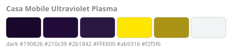

### Casa Mobile Signalred Rose

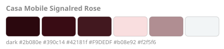

### Casa Mobile Cherry Hacker

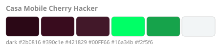

### Casa Mobile Clay Ivory

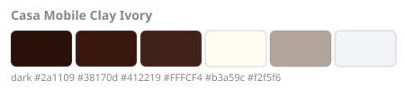

### Casa Mobile Ribbon Catskill

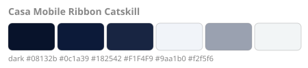

### Casa Mobile Navy Lime

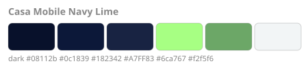

### Casa Mobile Azure Cloud

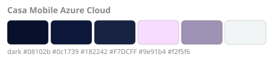

### Casa Mobile Cosmic Pastel

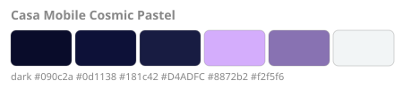

### Casa Mobile Signalred Almond

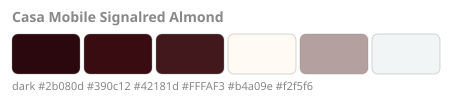

### Casa Mobile Teal Sage

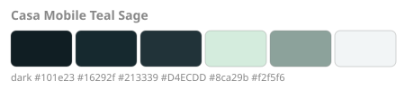

### Casa Mobile Orange Porcelain

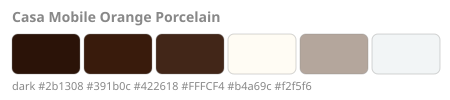

### Casa Mobile Signalviolet Mist

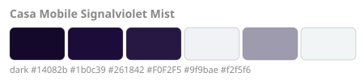

### Casa Mobile Promptblue Aigreen

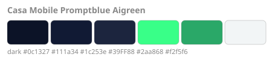

### Casa Mobile Inkberry Peach

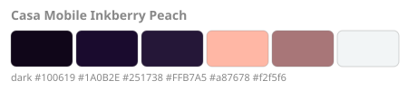

### Casa Mobile Ink Dusk

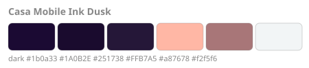

### Casa Mobile Violet Seafoam

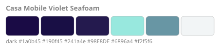

### Casa Mobile Violet Cyan

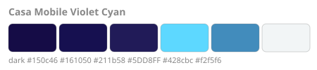

### Casa Mobile Graphite Mint

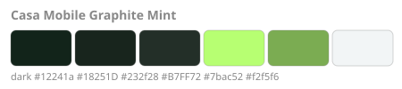

The swatches show page, card, dialog, accent, icon tint and text. Add real screenshots to `images/` for the HACS page.

## Credit

Built on the Noctis theme from [Clooos/Home-Assistant-Mobile-First](https://github.com/Clooos/Home-Assistant-Mobile-First) (MIT, (c) 2023 Cloos Quentin), with the card-mod parts removed and the design tokens extended. See `LICENSE`.
